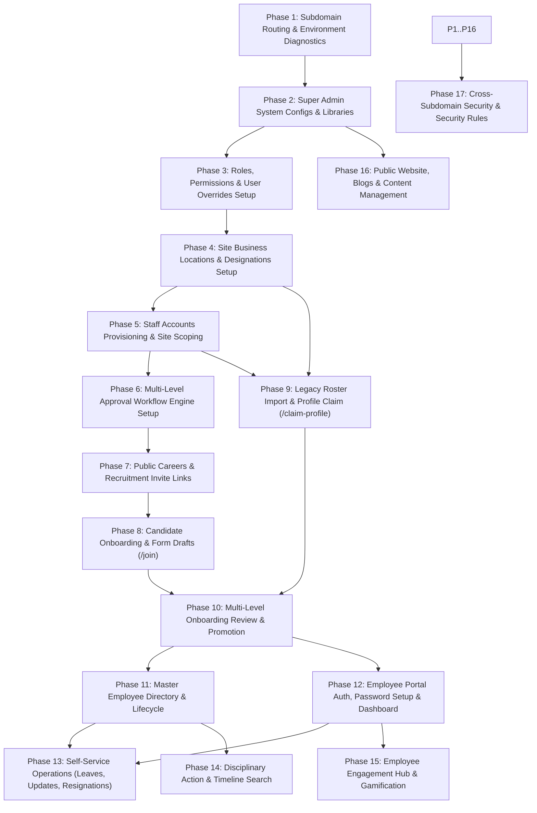

# 🧪 Master End-to-End Manual Test Plan: UDF Subdomains

This master manual test plan covers all domains, subdomains, features, workflows, edge cases, role-based security rules, and data operations across the UDF Subdomains platform (`udfonline.in`, `admin.udfonline.in`, `employee.udfonline.in`).

> [!IMPORTANT]
> **STRICT PREREQUISITE DEPENDENCY DESIGN**
> This test plan is engineered sequentially. **Phase 1 and Phase 2 create the necessary system configurations**, **Phases 3–6 set up roles, sites, staff, and workflows**, **Phase 7 generates recruitment links**, **Phase 8 creates candidate onboarding submissions**, **Phase 10 promotes candidates to official employee records**, which enables testing **Phases 11–17 (Employee Portal, Self-Service, Resignations, Disciplinary Actions, Engagement, and Public Website)**.
> **Each test step produces data required for subsequent tests.**

---

## 📑 Master Phase Index & Dependency Flowchart

---

## 🌐 Phase 1: Subdomain Routing & Environment Diagnostics
*Prerequisite:* Local dev environment or server deployment available (`npm run dev`, `npm run dev:admin`, `npm run dev:employee`).
*Goal:* Verify build target isolation (`VITE_APP_TARGET`), domain routing, loading spinners, and network diagnostic banners.

| Test ID | Test Step / Action | Expected Result | Status | Prerequisite Data Generated / Remarks |
|:---:|---|---|:---:|---|
| **1.1** | Launch Admin Subdomain build (`VITE_APP_TARGET=admin`). Navigate to `/`. | App automatically redirects `/` to `/login` or `/dashboard`. Admin Login layout renders. | [x] Pass [ ] Fail | Prepares environment for Admin auth. |
| **1.2** | Launch Employee Subdomain build (`VITE_APP_TARGET=employee`). Navigate to `/`. | App automatically redirects `/` to main site login redirect (`RedirectToMainLogin`). | [x] Pass [ ] Fail | Validates employee isolation. |
| **1.3** | Launch Unified Main Site build (`VITE_APP_TARGET=main` or default). Navigate to `/`. | Main website landing/blog page loads smoothly. | [x] Pass [ ] Fail | Validates main public site entry. |
| **1.4** | Open Developer Console (F12) on page load. | No console errors or missing bundle chunks. Lazy fallback spinner renders during route split transitions. | [x] Pass [ ] Fail | Confirms React lazy loading integrity. |
| **1.5** | Simulate network offline / slow 3G mode. | Global connection banner "Connection Troubleshooter" displays if Firestore disconnects. | [x] Pass [ ] Fail | Verifies offline alert banner. |

---

## ⚙️ Phase 2: Super Admin Initial System Setup & Global Configurations
*Prerequisite:* Phase 1 complete. Initial Super Admin credentials (`admin@uniquedelta.com`).
*Goal:* Configure global portal toggles, database operation caps, leave policy defaults, client ID definitions library, and designations library.

| Test ID | Test Step / Action | Expected Result | Status | Prerequisite Data Generated / Remarks |
|:---:|---|---|:---:|---|
| **2.1** | Log in as Super Admin (`admin@uniquedelta.com`) at `/admin/login`. | Authenticates successfully. Redirected to `/admin/dashboard`. Session stored in auth context. | [x] Pass [ ] Fail | Establishes Super Admin session. |
| **2.2** | Navigate to **Portal Config** (`/admin/portal-config`). Enable all module toggles: Leaves, Account Updates, Resignations, Disciplinary. Set DB caps. | Config document `portal_config/global` updates in Firestore. | [x] Pass [ ] Fail | Activates all portal modules. |
| **2.3** | Navigate to **Leave Policy** (`/admin/leave-policy`). Set default quotas: Casual (12), Sick (7), Earned (15), Unpaid (30). Toggle "Show Balances To Employees". | Document `leave_policy/global` updates in Firestore. | [x] Pass [ ] Fail | Sets company leave policy standards. |
| **2.4** | Navigate to **Global Client ID Library** (`/admin/client-id-definitions`). Add Definitions: 1. "BPSS ID" (Type: Alphanumeric, Pattern: `^[A-Z0-9]{8,12}$`)  2. "EPF ID" (Type: Uppercase, Pattern: `^[A-Z]{5}[0-9]{17}$`). | Saves definitions to `portal_config/global.clientIdDefinitions`. | [x] Pass [ ] Fail | Creates Global Client ID Library entries for later site mapping. |
| **2.5** | Open **Master Designations Library** modal (`/admin/designations`). Add Designations: - "Security Guard" - "Site Supervisor" - "Field Officer" - "Facility Manager" - "Operations Executive". | Designations saved globally in settings. | [x] Pass [ ] Fail | Populates global designations list. |

---

## 🛡️ Phase 3: Roles, Permissions Matrix & User Overrides Setup
*Prerequisite:* Phase 2 complete.
*Goal:* Configure role permissions, field visibility rules for data masking, user-specific permission overrides, and Super Admin lockdown safety.

| Test ID | Test Step / Action | Expected Result | Status | Prerequisite Data Generated / Remarks |
|:---:|---|---|:---:|---|
| **3.1** | Navigate to **Role Management** (`/admin/roles`). Create/Verify Role: **"Field Officer"** with permissions: `SUBMISSIONS_VIEW`, `SUBMISSIONS_APPROVE`, `LEAVES_VIEW`, `LEAVES_APPROVE`, `ACCOUNT_UPDATES_VIEW`, `ACCOUNT_UPDATES_APPROVE`, `INVITES_CREATE`, `EMPLOYEES_VIEW`. | Role saved in `/roles/role-field-officer`. | [x] Pass [ ] Fail | Establishes Field Officer role matrix. |
| **3.2** | Create/Verify Role: **"Site Manager"** with permissions: `SUBMISSIONS_VIEW`, `SUBMISSIONS_APPROVE`, `LEAVES_VIEW`, `LEAVES_APPROVE`, `LEAVES_REJECT`, `RESIGNATIONS_VIEW`, `RESIGNATIONS_APPROVE`, `EMPLOYEES_VIEW`, `DISCIPLINE_MANAGE`. | Role saved in `/roles/role-site-manager`. | [x] Pass [ ] Fail | Establishes Site Manager role matrix. |
| **3.3** | Create/Verify Role: **"HR Manager"** with permissions: `SUBMISSIONS_VIEW_SCOPE_ALL`, `SUBMISSIONS_APPROVE`, `SUBMISSIONS_ASSIGN_EMPLOYEE_ID`, `LEAVES_VIEW_SCOPE_ALL`, `LEAVES_APPROVE`, `LEAVES_MANAGE_BALANCES`, `ACCOUNT_UPDATES_VIEW_SCOPE_ALL`, `ACCOUNT_UPDATES_APPROVE`, `RESIGNATIONS_VIEW_SCOPE_ALL`, `RESIGNATIONS_APPROVE`, `EMPLOYEES_VIEW_SCOPE_ALL`, `EMPLOYEES_EDIT_PROFILE`, `EMPLOYEES_ACTION_RELIEVE`, `EMPLOYEES_ACTION_REJOIN`, `EMPLOYEES_CORRECT_ID`, `INVITES_VIEW_ALL`, `INVITES_MANAGE`, `EXPORT_DATA`. | Role saved in `/roles/role-hr-manager`. | [ ] Pass [ ] Fail | Establishes HR Manager role matrix. |
| **3.4** | Edit "Field Officer" Role **Field Visibility Rules**: Set `Aadhaar Number`, `Bank Account Number`, and `Salary Details` to `HIDDEN` or `READ_ONLY`. | Saves `fieldVisibility` rules in role document. | [x] Pass [ ] Fail | Configures data masking rules for Field Officers. |
| **3.5** | Navigate to **User Specific Permissions** (`/admin/user-permissions`). Select a user. Toggle an explicit override (e.g. Grant `EXPORT_DATA` = `true`). | Saves `permissionOverrides` map on user record. Explicit override takes precedence over Role. | [ ] Pass [ ] Fail | Configures explicit user override system. |
| **3.6** | Select "Inherit" (`null`) for an override setting. Click "Reset Overrides". | Reverts override state; user inherits exact role permissions. | [ ] Pass [ ] Fail | Tests single-click override reset. |
| **3.7** | Attempt to modify Super Admin (`role-super-admin`) permissions or delete the role. | UI locks toggles and delete buttons for Super Admin. System denies modifications to prevent lockout. | [ ] Pass [ ] Fail | Verifies Super Admin role protection. |
| **3.8** | **Live Staff Login & Sidebar Scoping Test:** Log out of Super Admin. Log in at `/admin/login` using a Field Officer staff account. | Navigation sidebar dynamically filters: shows Submissions, Leaves, Updates; hides Role Management, Portal Config, and Staff Management. | [ ] Pass [ ] Fail | Verifies live role-based menu scoping on staff account. |
| **3.9** | **Live Route Guard Enforcement Test:** While logged in as Field Officer, type `/admin/roles` or `/admin/portal-config` directly in URL address bar. | `AuthGuard` intercepts route attempt and displays "Access Denied: You do not have permission to view this section." | [ ] Pass [ ] Fail | Verifies live URL security guard on staff account. |
| **3.10** | **Live Explicit Override Precedence Test:** As Super Admin, grant `EXPORT_DATA: true` override to Field Officer user. Log in as Field Officer $\rightarrow$ Check Employee Directory. Reset override $\rightarrow$ Log in again. | When override is `true`, "Export CSV" button appears in Directory. When reset to `false`/`null`, "Export CSV" button disappears. | [ ] Pass [ ] Fail | Verifies live explicit user override precedence. |
| **3.11** | **Live Field Privacy Data Masking Test:** Log in as Field Officer $\rightarrow$ View Candidate Submission details. Log in as HR Manager $\rightarrow$ View same Candidate details. | Field Officer sees `•••• ••••` for Aadhaar & Bank fields. HR Manager sees full unmasked plain text details. | [ ] Pass [ ] Fail | Verifies live data privacy masking on staff account. |

---

## 🏢 Phase 4: Site Business Locations & Designations Setup
*Prerequisite:* Phases 2 & 3 complete.
*Goal:* Set up physical site locations, sub-units, map allowed designations, and map required Client IDs.

| Test ID | Test Step / Action | Expected Result | Status | Prerequisite Data Generated / Remarks |
|:---:|---|---|:---:|---|
| **4.1** | Navigate to **Site Management** (`/admin/sites`). Add Site: **"Hyderabad Tech Park"** (Code: `HTP-01`, Location: `Hyderabad`, Address: `HITEC City, Madhapur`, Contact: `+91 9876543210`, Maps Link: `https://maps.google.com/?q=hitec`). | Site created in `/sites/site-htp-01`. Status: Active. | [ ] Pass [ ] Fail | **Site 1 Created:** Hyderabad Tech Park. |
| **4.2** | Add Sub-Units to "Hyderabad Tech Park":  1. "Tower A (icres)" 2. "Tower B (main)". | Sub-units appended to `site.subUnits` array. Status: Active. | [ ] Pass [ ] Fail | Creates Sub-Units for Site 1. |
| **4.3** | Add Site: **"Bangalore Logistics Hub"** (Code: `BLR-02`, Location: `Bangalore`, Address: `Whitefield`). | Site created in `/sites/site-blr-02`. | [ ] Pass [ ] Fail | **Site 2 Created:** Bangalore Logistics Hub. |
| **4.4** | Edit "Hyderabad Tech Park". In **Authorized Designations** checklist, select: "Security Guard", "Site Supervisor", "Field Officer". | Saves `allowedDesignations` array. | [ ] Pass [ ] Fail | Restricts Site 1 to specific designations. |
| **4.5** | In **Required Client IDs** checklist for "Hyderabad Tech Park", select "BPSS ID". | Saves `requiredClientIdIds` referencing BPSS ID definition. | [ ] Pass [ ] Fail | Sets mandatory Client ID requirement for Site 1. |
| **4.6** | Open Form Builder (`/admin/form-builder`). Inspect "Designation" field options card. | Displays information banner: *"Designation options are dynamically filtered based on candidate site selection."* | [ ] Pass [ ] Fail | Confirms dynamic Form Builder integration. |

---

## 👥 Phase 5: Staff Accounts Provisioning & Scope Delegation
*Prerequisite:* Phases 3 & 4 complete.
*Goal:* Create Staff accounts via Cloud Function (`createStaffUser`), delegate site management scope (`sitesManaged`), verify global email uniqueness, and test password reset / account disabling.

| Test ID | Test Step / Action | Expected Result | Status | Prerequisite Data Generated / Remarks |
|:---:|---|---|:---:|---|
| **5.1** | Navigate to **Staff Management** (`/admin/staff`). Create Staff Account: - Name: **"Ramesh Kumar"** - Username: `ramesh_fo` - Email: `ramesh.fo@uniquedelta.com` - Password: `Pass@123456` - Role: **Field Officer** - Sites Managed: **"Hyderabad Tech Park"**. | Calls `createStaffUser` Cloud Function. Creates Firebase Auth user and document in `/staff_accounts/`. | [ ] Pass [ ] Fail | **Staff User 1 Created:** Field Officer for Site 1. |
| **5.2** | Create Staff Account: - Name: **"Suresh Reddy"** - Username: `suresh_mgr` - Email: `suresh.mgr@uniquedelta.com` - Password: `Pass@123456` - Role: **Site Manager** - Sites Managed: **"Hyderabad Tech Park"**, **"Bangalore Logistics Hub"**. | Staff account created in `/staff_accounts/`. | [ ] Pass [ ] Fail | **Staff User 2 Created:** Site Manager for Sites 1 & 2. |
| **5.3** | Create Staff Account: - Name: **"Priya Sharma"** - Username: `priya_hr` - Email: `priya.hr@uniquedelta.com` - Password: `Pass@123456` - Role: **HR Manager** - Sites Managed: All Sites (empty array or all selected). | Staff account created in `/staff_accounts/`. | [ ] Pass [ ] Fail | **Staff User 3 Created:** HR Manager for All Sites. |
| **5.4** | **Negative Test (Email Uniqueness):** Attempt to create another Staff user with email `ramesh.fo@uniquedelta.com`. | Cloud Function `checkGlobalUniqueness` throws `already-exists` error: *"Email is already registered as Admin, Staff, or Employee."* | [ ] Pass [ ] Fail | Verifies global identity uniqueness. |
| **5.5** | Edit "Ramesh Kumar". Enter new password `NewPass@2026` in Reset Password card. Click Reset. | Calls `resetStaffUserPassword` Cloud Function. Updates Firebase Auth password. Ramesh can log in with new password. | [ ] Pass [ ] Fail | Tests staff password reset. |
| **5.6** | Toggle Status to **Disabled** for "Ramesh Kumar". Attempt login as Ramesh. | Firestore `isDisabled: true`. Firebase Auth account marked disabled. Login attempt fails with `"Account disabled"` alert. | [ ] Pass [ ] Fail | Verifies account disabling sync. |
| **5.7** | Toggle Status back to **Active** for Ramesh Kumar. Attempt login. | Auth account re-enabled. Login succeeds immediately. | [ ] Pass [ ] Fail | Verifies account re-enabling. |
| **5.8** | Select a temporary staff user. Test **Smart Delete ("Clean Links")**. | Account deleted; supervisor/assignee fields in linked sites/reviews cleared without deleting the sites. | [ ] Pass [ ] Fail | Tests Smart Delete link cleaning. |

---

## 🔀 Phase 6: Multi-Level Approval Workflow Engine Setup
*Prerequisite:* Phases 3, 4 & 5 complete.
*Goal:* Configure approval levels for Onboarding Submissions, Leaves, Account Updates, and Resignations.

| Test ID | Test Step / Action | Expected Result | Status | Prerequisite Data Generated / Remarks |
|:---:|---|---|:---:|---|
| **6.1** | Navigate to **Workflow Configuration** (`/admin/workflows`). Select Module: **Onboarding Submissions**. | Workflow config editor opens. | [ ] Pass [ ] Fail | Prepares submission workflow. |
| **6.2** | Configure Submissions Workflow: - Level 1: **Field Officer** - Level 2: **Site Manager** - Level 3: **HR Manager**. Click Save. | Document `workflows/SUBMISSIONS` saves `levels` array in Firestore. | [ ] Pass [ ] Fail | **Submission Workflow Configured (3 Levels).** |
| **6.3** | Configure **Leave Requests** Workflow: - Level 1: **Field Officer** - Level 2: **Site Manager** - Level 3: **HR Manager**. | Document `workflows/LEAVES` updates. | [ ] Pass [ ] Fail | **Leaves Workflow Configured.** |
| **6.4** | Configure **Account Updates** Workflow: - Level 1: **Site Manager** - Level 2: **HR Manager**. | Document `workflows/ACCOUNT_UPDATES` updates. | [ ] Pass [ ] Fail | **Account Updates Workflow Configured.** |
| **6.5** | Configure **Resignations** Workflow: - Level 1: **Site Manager** - Level 2: **HR Manager**. | Document `workflows/RESIGNATIONS` updates. | [ ] Pass [ ] Fail | **Resignations Workflow Configured.** |

---

## 📢 Phase 7: Public Careers, Job Vacancies & Recruitment Referral Links
*Prerequisite:* Phases 4 & 5 complete.
*Goal:* Create job vacancies, generate candidate invite links (with prefilled values, phone locking, reusable link toggles), test WhatsApp share, and track analytics.

| Test ID | Test Step / Action | Expected Result | Status | Prerequisite Data Generated / Remarks |
|:---:|---|---|:---:|---|
| **7.1** | Log in as HR Manager (`priya.hr@uniquedelta.com`). Navigate to **Vacancy Manager** (`/admin/vacancies`). Click "Add Vacancy". | Vacancy modal opens. | [ ] Pass [ ] Fail | Prepares job vacancy creation. |
| **7.2** | Create Vacancy: - Title: **"Security Guard"** - Site: **"Hyderabad Tech Park"** - Count: 5 - Salary: "₹18,000 - ₹22,000/month" - Status: **Open**. | Saved in `/vacancies/`. Site name denormalized. Appears on Public Careers page (`/careers`). | [ ] Pass [ ] Fail | **Vacancy 1 Created.** |
| **7.3** | Log in as Field Officer (`ramesh.fo@uniquedelta.com`). Navigate to **Recruitment & Referral Invites** (`/admin/invites`). Click "Generate Invite Link". | Link generator opens. Site dropdown shows only "Hyderabad Tech Park" (Ramesh's assigned site). | [ ] Pass [ ] Fail | Tests site scoping during link creation. |
| **7.4** | Configure Link 1: - Site: **"Hyderabad Tech Park"** - Designation: **"Security Guard"** - Lock Candidate Phone: **Enabled** (`+91 9876500001`)  - Prefill Fields: Full Name = "Anil Verma" - Lock Prefilled Fields: **Enabled**. Click Generate. | Document created in `/referral_invites/`. Unique Token ID generated. | [ ] Pass [ ] Fail | **Invite Link 1 Generated:** Phone-locked & prefilled for Anil Verma. |
| **7.5** | Generate Link 2: - Site: **"Hyderabad Tech Park"** - Designation: **"Site Supervisor"** - Reusable Link: **Enabled** (Permanent) - Expiration & Phone Lock automatically hidden. | Reusable invite created with `isReusable: true`. Badge shows "Permanent/Reusable" in tracker. | [ ] Pass [ ] Fail | **Invite Link 2 Generated:** Reusable Permanent Link. |
| **7.6** | Click WhatsApp share button on Link 1. | Directly opens WhatsApp web/app chat to `+919876500001` with styled referral message and link token. | [ ] Pass [ ] Fail | Tests WhatsApp direct routing. |
| **7.7** | Edit Link 1 in tracker: Change prefilled designation or custom note. Open link in incognito. | Tracker updates. Candidate form loads updated prefilled values immediately. | [ ] Pass [ ] Fail | Verifies active invite link editing. |
| **7.8** | Test permissions guard: Log in as a staff member lacking `INVITES_VIEW_ALL`. Open Tracker. | Shows ONLY links created by this staff user. Staff filter dropdown is hidden. | [ ] Pass [ ] Fail | Tests `INVITES_VIEW_ALL` scoping guard. |

---

## 📝 Phase 8: Candidate Onboarding & Form Drafts (/join)
*Prerequisite:* Phases 4, 7 complete.
*Goal:* Complete candidate onboarding wizard steps as Guest / Google user, validate phone locking, parse Aadhaar PDF, save/recover draft tokens, and trigger clean submission with upload progress.

| Test ID | Test Step / Action | Expected Result | Status | Prerequisite Data Generated / Remarks |
|:---:|---|---|:---:|---|
| **8.1** | Open Invite Link 1 in incognito window (`/join?ref=<token_1>`). | Welcome page loads. Shows prefilled Site ("Hyderabad Tech Park") and Designation ("Security Guard"). | [ ] Pass [ ] Fail | Verifies invite link candidate landing. |
| **8.2** | Select **Guest Onboarding**. | Creates anonymous auth session. Advances to Step 1. Amber banner displays recovery code prompt. | [ ] Pass [ ] Fail | Begins candidate onboarding. |
| **8.3** | **Phone Lock Check:** Attempt to enter phone number `+91 9999999999`. | System rejects entry; input is locked to `+91 9876500001` as configured in Invite Link 1. | [ ] Pass [ ] Fail | Verifies phone locking guard. |
| **8.4** | **Step 1 (Personal Details):** Fill Name ("Anil Verma"), DOB ("1995-05-15" - age 31), Blood Group ("O+"), Height ("175 cm"), Marital Status ("Married"). | Spouse Name field dynamically appears. Fill Spouse Name ("Sunita Verma"). Click Next. | [ ] Pass [ ] Fail | Validates Step 1 conditional inputs. |
| **8.5** | **Step 2 (Job Details):** Site and Designation are prefilled & disabled. Toggle Police Case ("No"), Previous Experience ("Yes" -> Fill "2 years at XYZ Security"). Click Next. | Advanced to Step 3. | [ ] Pass [ ] Fail | Validates Step 2 job fields. |
| **8.6** | **Step 3 (Address Details):** Fill Present Address ("Plot 42, Gachibowli, Hyderabad, 500032"). Check "Same as Present Address". | Permanent Address text auto-copies and field becomes disabled. Click Next. | [ ] Pass [ ] Fail | Validates Step 3 auto-copy checkbox. |
| **8.7** | **Step 4 (Reference Details):** Name ("Rajesh Kumar"), Relationship ("Friend"), Phone ("9123456789"). Click Next. | Validates 10-digit numeric phone rule. Advances to Step 5. | [ ] Pass [ ] Fail | Validates Step 4 reference details. |
| **8.8** | **Step 5 (Family Details):** Father Name ("Ram Verma", Phone "9811122233"), Mother Name ("Sita Verma", Phone "9811122244"). Click Next. | Validates parents 10-digit mobile rule. Advances to Step 6. | [ ] Pass [ ] Fail | Validates Step 5 family details. |
| **8.9** | **Step 6 (Govt IDs & Aadhaar Parsing):** Enter PAN ("ABCDE1234F"). Click **"Aadhaar Autofill"**. Upload password-protected Aadhaar PDF. | Modal prompts for password. Enter password. Client decrypts PDF, downloads unlocked copy, and autofills Aadhaar No, Name, DOB, Gender, Address. | [ ] Pass [ ] Fail | **Verifies Aadhaar PDF Client Decryption & Autofill.** |
| **8.10** | **Step 7 (Bank Details):** Bank Name ("State Bank of India"), Account No ("123456789012"), IFSC Code ("SBIN0001234"). Click Next. | Validates IFSC alphanumeric 11-char pattern. Advances to Step 8. | [ ] Pass [ ] Fail | Validates Step 7 bank formatting. |
| **8.11** | **Step 8 (Uploads & Draft Save):** Upload Photo (`photo.jpg`, 1.2MB), Aadhaar Card (`aadhaar.pdf`, 2MB), PAN Card (`pan.jpg`, 1.5MB), Bank Passbook (`bank.pdf`, 1MB). | Real-time storage folder size calculator shows total folder size (~5.7MB). | [ ] Pass [ ] Fail | Prepares document attachments. |
| **8.12** | Click **"Save Draft"**. Note 6-character recovery token (e.g. `DRF-8X2K9L`). | Saves encrypted data to `/draft_submissions/`. Displays recovery token popup. | [ ] Pass [ ] Fail | Creates Draft Submission. |
| **8.13** | Refresh browser tab or clear session. Re-open `/join`. Click "Retrieve Draft". Enter `DRF-8X2K9L`. | Restores all 8 steps of form data and file selections instantly. | [ ] Pass [ ] Fail | **Verifies Draft Recovery Token.** |
| **8.14** | Click **"Submit Application"**. | Upload progress bar shows per-file progress (0% -> 100%). Deletes draft token. Submits to `/onboarding_submissions/`. Displays Success Page with Ref ID `SUB-2026-001`. | [ ] Pass [ ] Fail | **Submission 1 Created (Pending Review):** Anil Verma (Site 1). Increments Invite 1 Starts count. |
| **8.15** | Open Invite Link 2 (Reusable Link). Complete submission for Candidate 2: **"Bhavani Singh"** (Site 1, "Site Supervisor", Phone `9876500002`). Submit application. | Ref ID `SUB-2026-002` created. Invite 2 tracker updates Joins counter. | [ ] Pass [ ] Fail | **Submission 2 Created (Pending Review):** Bhavani Singh (Site 1). |

---

## 📥 Phase 9: Legacy Roster Import & Profile Claim Loop (/claim-profile)
*Prerequisite:* Phases 4 & 5 complete.
*Goal:* Perform Admin bulk import of legacy roster data (`legacy_employee_imports`), verify employee profile claim lookup via `/claim-profile`, and verify profile claim conversion.

| Test ID | Test Step / Action | Expected Result | Status | Prerequisite Data Generated / Remarks |
|:---:|---|---|:---:|---|
| **9.1** | Log in as Super Admin. Navigate to **Legacy Roster Systems** (`/admin/legacy-systems`). Upload test Excel roster containing record: - Old Emp ID: `LEG-901` - Full Name: **"Chandra Sekhar"** - Phone: `9876500003` - Aadhaar: `123456789012` - DOB: `1992-08-20` - Designation: "Security Guard". | Row parsed and imported to `/legacy_employee_imports/LEG-901`. Status: Unclaimed (`claimed: false`). | [ ] Pass [ ] Fail | **Legacy Record Created:** LEG-901 (Chandra Sekhar). |
| **9.2** | Open Profile Claim page in candidate browser (`/claim-profile`). Enter Old Emp ID `LEG-901` and Mobile Number `9876500003`. Click "Verify Profile". | System matches legacy import document. Displays candidate preview card with matched name "Chandra Sekhar". | [ ] Pass [ ] Fail | Verifies legacy profile verification lookup. |
| **9.3** | **Negative Test:** Enter incorrect DOB or Phone number during claim. | Throws generic error: *"Verification details do not match existing roster records."* | [ ] Pass [ ] Fail | Prevents unauthorized profile claims. |
| **9.4** | Click "Claim This Profile". Complete onboarding details form and submit. | Updates legacy import doc `claimed: true`, `claimedAt: timestamp`. Creates candidate submission `SUB-2026-003` linked via `legacyImportId`. | [ ] Pass [ ] Fail | **Submission 3 Created via Profile Claim:** Chandra Sekhar. |

---

## ⚖️ Phase 10: Multi-Level Onboarding Review, Profile Correction & Approval Promotion
*Prerequisite:* Phases 5, 6, 8, 9 complete (Submissions 1, 2, 3 pending review).
*Goal:* Test scoped review queues per role, detail inspection, data masking, biodata printing, profile correction workflow (`/correct-details`), multi-level approval progression, intermediate Employee ID assignment, and final promotion to `/employees`.

| Test ID | Test Step / Action | Expected Result | Status | Prerequisite Data Generated / Remarks |
|:---:|---|---|:---:|---|
| **10.1** | Log in as Field Officer **Ramesh Kumar** (`ramesh.fo@uniquedelta.com`). Open Onboarding Reviews (`/admin/submissions`). | Scoped banner "Assigned Sites Only" displays. Sees Submissions 1, 2, 3 for "Hyderabad Tech Park". Submissions for other sites are omitted. | [ ] Pass [ ] Fail | Verifies Field Officer scoped review queue. |
| **10.2** | Open detail modal for Submission 1 (Anil Verma). Check sensitive fields. | Sensitive fields set as `HIDDEN` in Field Officer role (Aadhaar, Bank Account) are masked/hidden in review UI. | [ ] Pass [ ] Fail | **Verifies Dynamic Field Privacy Masking.** |
| **10.3** | Click **"View/Print Biodata"** (requires `SUBMISSIONS_PRINT_BIODATA`). Inspect preview. | A4 paper formatted layout renders candidate photo (no `[object Object]` error). Print button opens clean print preview without navigation UI. | [ ] Pass [ ] Fail | Verifies A4 Biodata Sheet rendering. |
| **10.4** | **Profile Correction Loop:** Click "Request Correction". Select field "Bank Account Number" and type reason: *"IFSC code mismatch with passbook copy"*. Click Send. | Status changes to `Correction Required`. Generates token in `/correction_requests/`. | [ ] Pass [ ] Fail | Initiates Profile Correction request. |
| **10.5** | As Candidate Anil Verma, open correction link (`/correct-details?token=<token>`). | Verification page prompts for DOB & Mobile. After entering correct values, candidate form unlocks ONLY the "Bank Account Number" field. | [ ] Pass [ ] Fail | Tests candidate correction access control. |
| **10.6** | Edit Bank Account Number and click Resubmit Correction. | Document status reverts to `Pending Review` (Level 1). Review panel highlights updated field with green indicator. | [ ] Pass [ ] Fail | Completes correction loop. |
| **10.7** | Log in as Field Officer Ramesh. Click **"Approve (Level 1)"** on Submission 1. | Status advances to `currentLevel: 2`. Record moves to Site Manager queue. | [ ] Pass [ ] Fail | Level 1 Approval complete. |
| **10.8** | Log in as Site Manager **Suresh Reddy** (`suresh.mgr@uniquedelta.com`). Open Submissions. Click **"Approve (Level 2)"** on Submission 1. | Status advances to `currentLevel: 3`. Record moves to HR Manager queue. | [ ] Pass [ ] Fail | Level 2 Approval complete. |
| **10.9** | Log in as HR Manager **Priya Sharma** (`priya.hr@uniquedelta.com`). Open detail modal for Submission 1. | HR Manager sees unmasked fields (full access). Input box "Assign Permanent Employee ID" appears (`SUBMISSIONS_ASSIGN_EMPLOYEE_ID`). | [ ] Pass [ ] Fail | Verifies HR queue & ID assignment input. |
| **10.10** | Input Permanent Employee ID: `EMP-HTP-101`. Click **"Final Approve & Promote"**. | Performs promotion batch: 1. Creates document in `/employees/EMP-HTP-101` 2. Generates default password `1995@EMP-HTP-101` 3. Syncs Firebase Auth account 4. Creates Drive folder structure (`approveEmployeeFolder`) 5. Updates Invite 1 tracker `joined` counter. | [ ] Pass [ ] Fail | **ACTIVE EMPLOYEE 1 CREATED:** EMP-HTP-101 (Anil Verma). |
| **10.11** | Process Submission 2 (Bhavani Singh): Assign Employee ID `EMP-HTP-102` and perform Final Approval. | Active Employee 2 created: `EMP-HTP-102` (Bhavani Singh). Default password: `1990@EMP-HTP-102`. | [ ] Pass [ ] Fail | **ACTIVE EMPLOYEE 2 CREATED:** EMP-HTP-102 (Bhavani Singh). |
| **10.12** | Process Submission 3 (Chandra Sekhar): Assign Employee ID `EMP-HTP-103` and perform Final Approval. | Active Employee 3 created: `EMP-HTP-103` (Chandra Sekhar). Default password: `1992@EMP-HTP-103`. | [ ] Pass [ ] Fail | **ACTIVE EMPLOYEE 3 CREATED:** EMP-HTP-103 (Chandra Sekhar). |

---

## 📊 Phase 11: Master Employee Directory & Personnel Lifecycle Management
*Prerequisite:* Phase 10 complete (Employees `EMP-HTP-101`, `EMP-HTP-102`, `EMP-HTP-103` active in `/employees`).
*Goal:* Test Master Directory tabs, search, multi-column filter, CSV exports, deployment assignments, ID corrections, relieving/offboarding, rejoining/rehiring, and Recycle Bin soft/hard purges.

| Test ID | Test Step / Action | Expected Result | Status | Prerequisite Data Generated / Remarks |
|:---:|---|---|:---:|---|
| **11.1** | Log in as HR Manager (`priya.hr@uniquedelta.com`). Open **Master Employee Directory** (`/admin/master-list`). Inspect Active tab. | Lists active employees `EMP-HTP-101`, `EMP-HTP-102`, `EMP-HTP-103`. Stats widgets show accurate headcount (3). | [ ] Pass [ ] Fail | Verifies active directory listing. |
| **11.2** | Use **Global Search Box**: Type "Bhavani" or "EMP-HTP-102". | Instant client filtering filters list down to Employee `EMP-HTP-102`. | [ ] Pass [ ] Fail | Tests directory search speed. |
| **11.3** | Open **Column Customizer**: Toggle OFF "Blood Group" and "PAN Number". Toggle ON "Joining Date". | Table updates layout dynamically without refreshing page. | [ ] Pass [ ] Fail | Tests column customization. |
| **11.4** | Click **"Export CSV"** (requires `EXPORT_DATA`). | Downloads `.csv` file containing active employee dataset with active columns. | [ ] Pass [ ] Fail | Tests CSV data export. |
| **11.5** | Open detail drawer for `EMP-HTP-101`. Navigate to **Deployments & Site Assignments**. Click "Add Assignment". Select Site: "Bangalore Logistics Hub", Type: **OT (Overtime)**, Designation: "Site Supervisor". Save. | Appends record to `activeAssignments` array. Employee can now work at both primary and OT sites. | [ ] Pass [ ] Fail | Tests OT deployment assignment. |
| **11.6** | Open Client IDs section for `EMP-HTP-101`. Input BPSS ID: `BPSS12345678`. Save. | Validates regex pattern (`^[A-Z0-9]{8,12}$`). Saves value in `clientIds.BPSS ID`. | [ ] Pass [ ] Fail | Tests Client ID validation & storage. |
| **11.7** | Click **"Correct Employee ID"** on `EMP-HTP-103`. Change ID to `EMP-HTP-103X`. Save. | Updates Firestore doc ID & references. Re-indexes record smoothly. | [ ] Pass [ ] Fail | Tests Employee ID correction. |
| **11.8** | **Offboarding / Relieving Action:** Click "Relieve Employee" on `EMP-HTP-102` (Bhavani Singh). Select Relieving Reason: **"Resignation"**, Relieving Date: Today. Confirm. | Updates `isRelieved: true`, `relievingDate`. Moves employee from Active tab to **Relieved** tab. Archives Drive folder (`moveEmployeeFolderToRecycleBin`). Disables Firebase Auth login. | [ ] Pass [ ] Fail | **Relieves Employee 2:** EMP-HTP-102 offboarded. |
| **11.9** | **Rejoining / Rehiring Flow:** Open Relieved tab. Select `EMP-HTP-102`. Click **"Rejoin Employee"**. Select New ID: `EMP-HTP-202`. Set Joining Date: Today. Confirm. | Re-activates employee under new ID `EMP-HTP-202`. Appends previous stint (`EMP-HTP-102`, joining -> relieving) to `employmentHistory` array. Moves employee back to Active tab. | [ ] Pass [ ] Fail | **Rehires Employee 2:** Stint history preserved in profile. |
| **11.10** | **Recycle Bin & Hard Delete:** Select an old test employee. Click "Delete Employee". Confirm soft delete. | Sets `deletedAt: timestamp`. Moves record to **Recycle Bin** tab. | [ ] Pass [ ] Fail | Soft deletes employee. |
| **11.11** | Open Recycle Bin tab. Click **"Permanent Purge"**. | Calls `permanentDeleteEmployeeFolder`. Permanently deletes Firestore document and Storage folder. | [ ] Pass [ ] Fail | Tests hard purge deletion. |

---

## 🔑 Phase 12: Employee Portal Auth, Password Setup & Dashboard
*Prerequisite:* Phase 10 complete (Employee `EMP-HTP-101` active with default password `1995@EMP-HTP-101`).
*Goal:* Test employee login on employee subdomain/portal (`/login`), first-time password setup enforcement (`needsPasswordSetup`), profile avatar upload, attendance check-in calendar, and document upload wizard.

| Test ID | Test Step / Action | Expected Result | Status | Prerequisite Data Generated / Remarks |
|:---:|---|---|:---:|---|
| **12.1** | Navigate to Employee Login (`/login` on `employee.udfonline.in` or main site). Enter Username/ID: `EMP-HTP-101`, Password: `1995@EMP-HTP-101`. Click Login. | Authenticates successfully. Detects default password flag (`isDefaultPassword: true`). | [ ] Pass [ ] Fail | Performs first employee portal login. |
| **12.2** | System forces **First-Time Password Setup Modal**. Enter current password `1995@EMP-HTP-101` and new secure password `EmpPass@2026!`. Save. | Updates password hash in Firestore & Firebase Auth. Sets `isDefaultPassword: false`, `needsPasswordSetup: false`. Forwards to Employee Dashboard. | [ ] Pass [ ] Fail | **Sets permanent password for Employee 1.** |
| **12.3** | Inspect **Employee Dashboard Overview** (`/employee/dashboard`). | Displays employee profile card (Anil Verma), Site ("Hyderabad Tech Park"), Designation ("Security Guard"), and Leave Balance widgets. | [ ] Pass [ ] Fail | Verifies employee dashboard layout. |
| **12.4** | Click profile avatar icon. Select "Upload New Profile Picture". Upload `avatar.jpg` (800KB). Crop and save. | Crops image client-side, uploads to Storage path `employees/EMP-HTP-101/avatar.jpg`, updates `profilePhotoURL`. Header avatar updates instantly. | [ ] Pass [ ] Fail | Tests profile avatar upload & crop. |
| **12.5** | Open **Attendance Calendar** component on dashboard. Click "Mark Today's Attendance / Check-In". | Creates document in `/attendance/`. Calendar highlights today's date in green with check-in timestamp. | [ ] Pass [ ] Fail | Tests attendance check-in. |
| **12.6** | Open **Document Upload Wizard** (`/employee/documents`). Upload updated Driving License copy (`license.pdf`). Save. | Uploads file to employee folder in Storage. Adds document record to `profileData.documents`. | [ ] Pass [ ] Fail | Tests employee document uploads. |

---

## 🏖️ Phase 13: Employee Self-Service Operations & Multi-Level Workflows
*Prerequisite:* Phases 6, 11, 12 complete (Employee `EMP-HTP-101` logged in; Leave policies and multi-level workflows active).
*Goal:* Test candidate self-service requests (Leaves, Account Updates, Resignations), multi-level workflow escalation through Field Officer -> Site Manager -> HR Manager, balance deductions, profile auto-updates, and relieving lifecycle execution.

| Test ID | Test Step / Action | Expected Result | Status | Prerequisite Data Generated / Remarks |
|:---:|---|---|:---:|---|
| **13.1** | **Leave Request Submission:** Log in as Employee `EMP-HTP-101`. Navigate to `/employee/leaves`. Select Leave Type: **"Casual Leave"**, Dates: Tomorrow to Day After (2 days), Reason: *"Personal emergency"*. Submit. | Creates document in `/leave_requests/` with status `Pending` (`currentLevel: 1`). Notification sent to Field Officer. | [ ] Pass [ ] Fail | **Leave Request 1 Created (2 Days Casual Leave).** |
| **13.2** | Log in as Field Officer **Ramesh Kumar** (`ramesh.fo@uniquedelta.com`). Open Leave Management (`/admin/leaves`). Click **"Approve (Level 1)"** on Leave Request 1. | Status advances to `currentLevel: 2`. Request moves to Site Manager queue. | [ ] Pass [ ] Fail | Level 1 Leave Approval complete. |
| **13.3** | Log in as Site Manager **Suresh Reddy** (`suresh.mgr@uniquedelta.com`). Click **"Approve (Level 2)"** on Leave Request 1. | Status advances to `currentLevel: 3`. Request moves to HR Manager queue. | [ ] Pass [ ] Fail | Level 2 Leave Approval complete. |
| **13.4** | Log in as HR Manager **Priya Sharma** (`priya.hr@uniquedelta.com`). Click **"Final Approve (Level 3)"** on Leave Request 1. | Status changes to `Approved`. Deducts 2 days from Casual Leave balance in `/leave_balances/EMP-HTP-101` (12 -> 10 remaining). Sends approval notification to employee. | [ ] Pass [ ] Fail | **Final Leave Approval Complete:** Balance deducted (10 remaining). |
| **13.5** | **Account Update Request Submission:** Log in as Employee `EMP-HTP-101`. Navigate to `/employee/account-update`. Select Field: **"Present Address"**, New Value: *"Flat 101, HITEC Heights, Hyderabad"*, Upload Proof: `address_proof.pdf`. Submit. | Creates document in `/account_updates/` with status `Pending` (`currentLevel: 1`). | [ ] Pass [ ] Fail | **Account Update Request 1 Created.** |
| **13.6** | Process Account Update Request through Site Manager (Level 1 Approval) -> HR Manager (Level 2 Final Approval). | Status changes to `Approved`. **Firestore trigger / service automatically updates `profileData.personalDetails.presentAddress` in `/employees/EMP-HTP-101` doc.** | [ ] Pass [ ] Fail | **Account Update Approved & Profile Updated automatically.** |
| **13.7** | **Resignation Request Submission:** Log in as Employee `EMP-HTP-101`. Navigate to `/employee/resignation`. Select Resignation Date: Today, Requested Relieving Date: 30 days from today, Reason: *"Better opportunity"*, Attach Notice: `resignation_letter.pdf`. Submit. | Creates document in `/resignations/` with status `Pending` (`currentLevel: 1`). | [ ] Pass [ ] Fail | **Resignation Request 1 Created.** |
| **13.8** | Log in as Site Manager **Suresh Reddy**. Approve Resignation (Level 1). | Status advances to `currentLevel: 2`. | [ ] Pass [ ] Fail | Level 1 Resignation Approval complete. |
| **13.9** | Log in as HR Manager **Priya Sharma**. Click **"Final Approve (Level 2)"**. Set Confirmed Relieving Date. | Status changes to `Approved`. Updates employee status to `isRelieved: true` on relieving date, archives Drive folder, and blocks login access. | [ ] Pass [ ] Fail | **Resignation Final Approval Complete.** |

---

## ⚖️ Phase 14: Disciplinary Action Management & Unified Timeline Search
*Prerequisite:* Phases 10 & 11 complete (Active & Relieved employees exist).
*Goal:* File formal disciplinary notices (Warnings, Show Cause, Suspension, Termination), verify employee timeline entries, and test global unified timeline search.

| Test ID | Test Step / Action | Expected Result | Status | Prerequisite Data Generated / Remarks |
|:---:|---|---|:---:|---|
| **14.1** | Log in as Site Manager **Suresh Reddy** (`suresh.mgr@uniquedelta.com`). Navigate to **Disciplinary Management** (`/admin/disciplinary`). Click "File Disciplinary Action". | Disciplinary modal opens. | [ ] Pass [ ] Fail | Opens disciplinary filing modal. |
| **14.2** | File Disciplinary Action: - Employee: `EMP-HTP-103` (Chandra Sekhar) - Action Type: **"Written Warning"** - Date: Today - Description: *"Unannounced absence on shift date 22nd July."* - Attach File: `warning_letter.pdf`. Save. | Saves record to `/disciplinary_actions/`. Sends warning notification to employee. | [ ] Pass [ ] Fail | **Disciplinary Action 1 Created:** Written Warning. |
| **14.3** | Log in as Employee `EMP-HTP-103` on Employee Portal. Open Disciplinary tab (`/employee/disciplinary`). | Displays active Written Warning record with details and attached warning letter download. | [ ] Pass [ ] Fail | Verifies employee disciplinary notice view. |
| **14.4** | Log in as HR Manager. Navigate to **Unified Timeline Search** (`/admin/timeline-search`). Type "EMP-HTP-103" or "Chandra". | Renders chronological vertical timeline of all life events for `EMP-HTP-103`: 1. Candidate Submission (`SUB-2026-003`)  2. Approved & Promoted (`EMP-HTP-103`)  3. Disciplinary Action (Written Warning). | [ ] Pass [ ] Fail | **Verifies Unified Chronological Timeline Search.** |

---

## 🎮 Phase 15: Employee Engagement Hub, Quizzes & Gamification
*Prerequisite:* Phase 12 complete (Employee `EMP-HTP-103` logged in).
*Goal:* Test daily engagement check-ins, safety quizzes, complaints filing, and Cloud Functions security protection against points tampering.

| Test ID | Test Step / Action | Expected Result | Status | Prerequisite Data Generated / Remarks |
|:---:|---|---|:---:|---|
| **15.1** | Log in as Employee `EMP-HTP-103`. Navigate to **Engagement Hub** (`/employee/engagement`). | Hub opens showing daily quiz, check-in streak, points total, and complaints form. | [ ] Pass [ ] Fail | Opens Engagement Hub. |
| **15.2** | Complete **Daily Safety Quiz**: Answer 3 safety questions correctly. | Quiz submits. Cloud Function evaluates score and adds +50 reward points to `/user_engagement/EMP-HTP-103`. Streak counter increments. | [ ] Pass [ ] Fail | Tests safety quiz completion & reward points. |
| **15.3** | File a Complaint: Subject *"Uniform Replacement Request"*, Description *"Need size XL uniform top"*. Submit. | Saves document to `/complaints/`. Target user ID set to `EMP-HTP-103`. Appears in Admin Complaints view. | [ ] Pass [ ] Fail | Tests employee complaint filing. |
| **15.4** | **Security Check (Points Tampering):** Attempt to issue a client-side Firestore `updateDoc` directly mutating `points: 99999` on `/user_engagement/EMP-HTP-103`. | **Security Rule Rejection:** `firestore.rules` rejects write on `points` field mutation attempt from client. Only Cloud Functions can award points. | [ ] Pass [ ] Fail | **Verifies Points Anti-Tampering Security Rule.** |

---

## 📰 Phase 16: Public Website, Blog Engine & Content Management
*Prerequisite:* Phase 2 complete (Super Admin / System Manager logged in).
*Goal:* Manage public web content, blog posts, category tagging, feature images, and verify public website rendering (`udfonline.in`).

| Test ID | Test Step / Action | Expected Result | Status | Prerequisite Data Generated / Remarks |
|:---:|---|---|:---:|---|
| **16.1** | Log in as Super Admin. Navigate to **Website & Blog Manager** (`/admin/website-manager`). Click "Create New Post". | Blog editor modal opens. | [ ] Pass [ ] Fail | Opens blog editor. |
| **16.2** | Create Blog Post: - Title: *"Safety Standards in Security Services 2026"* - Slug: `safety-standards-2026` - Category: "Safety & Compliance" - Cover Image: `cover.jpg` (uploaded) - Content: Rich text content with headings, bullet points, images - Status: **Published**. Save. | Document saved in `/blog_posts/`. Post becomes live immediately. | [ ] Pass [ ] Fail | **Blog Post 1 Published.** |
| **16.3** | Open Public Website in incognito (`/blogs`). Inspect main blog feed. | Post *"Safety Standards in Security Services 2026"* displays at top of feed with thumbnail, category badge, and read time. | [ ] Pass [ ] Fail | Verifies public blog listing. |
| **16.4** | Click on post card to load `/blogs/safety-standards-2026`. | Full article renders cleanly with single `<h1>`, meta description, rich formatting, and share icons. | [ ] Pass [ ] Fail | Verifies full blog post detail view. |
| **16.5** | Test Public Static Pages: Navigate to `/about`, `/business`, `/contact`, `/careers`, `/privacy-policy`, `/terms-of-service`. | All pages render properly with responsive layouts, working contact forms, and no broken links. | [ ] Pass [ ] Fail | Tests all public marketing pages. |

---

## 🔒 Phase 17: Cross-Subdomain Security, Scope Isolation & Edge-Case Audit
*Prerequisite:* All previous phases complete.
*Goal:* Execute negative security tests, direct URL navigation bypass checks, Firestore security rules enforcement, and audit log tracking (`audit_logs`).

| Test ID | Test Step / Action | Expected Result | Status | Prerequisite Data Generated / Remarks |
|:---:|---|---|:---:|---|
| **17.1** | **URL Access Guard (Unauthenticated):** Copy URL `/admin/dashboard`. Log out completely. Paste `/admin/dashboard` in browser. | `AuthGuard` intercepts route attempt and redirects immediately back to `/admin/login`. | [ ] Pass [ ] Fail | Prevents unauthorized admin access. |
| **17.2** | **Role Access Guard (Employee on Admin Route):** Log in as Employee `EMP-HTP-101`. Paste `/admin/dashboard` in browser URL. | `AuthGuard` checks `allowedUserTypes=[UserType.ADMIN]`, denies access, and redirects user to `/employee/dashboard` or `/login`. | [ ] Pass [ ] Fail | Prevents privilege escalation. |
| **17.3** | **Security Rules Write Guard (Direct Firestore Write):** Open browser dev tools console while logged in as Field Officer `ramesh.fo`. Attempt direct console write: `db.collection('roles').doc('role-super-admin').update({ permissions: [...] })`. | Firebase SDK throws error: `FirebaseError: [Cloud Firestore]: Missing or insufficient permissions.` | [ ] Pass [ ] Fail | **Verifies Firestore Security Rules write rejection.** |
| **17.4** | **Audit Log Verification:** Log in as Super Admin. Navigate to **Audit Logs** (`/admin/audit-logs`). | Table displays complete audit log history (`/audit_logs/`): - Staff account creations - Role updates - Candidate approvals & promotions - Leave approvals - Disciplinary filings. Includes Actor ID, Actor Name, Action Type, Target Module, Timestamp. | [ ] Pass [ ] Fail | **Verifies Complete System Audit Log Trail.** |

---

## 📋 Comprehensive Execution Summary Checklist

| Phase | Phase Name | Total Tests | Dependency Status | Verification Notes |
|:---:|---|:---:|:---:|---|
| **Phase 1** | Subdomain Routing & Diagnostics | 5 | Ready | ✅ **PASSED (5/5)** |
| **Phase 2** | Super Admin System Configs & Libraries | 5 | Requires P1 | ✅ **PASSED (5/5)** |
| **Phase 3** | Roles, Permissions & Overrides | 11 | Requires P2 | Configures RBAC matrix, live staff login & data masking |
| **Phase 4** | Site Locations & Designations | 6 | Requires P2, P3 | Creates Sites 1 & 2 + Designation maps |
| **Phase 5** | Staff Provisioning & Scoping | 8 | Requires P3, P4 | Provisions Field Officer, Manager & HR staff |
| **Phase 6** | Multi-Level Workflow Engine | 5 | Requires P3..P5 | Configures 3-tier approval sequences |
| **Phase 7** | Public Careers & Recruitment Invites | 8 | Requires P4, P5 | Creates Job Vacancies & Invite Links |
| **Phase 8** | Candidate Onboarding & Form Drafts | 15 | Requires P4, P7 | Submits Candidates 1 & 2 + Draft Tokens |
| **Phase 9** | Legacy Roster Import & Profile Claim | 4 | Requires P4, P5 | Imports Legacy Roster & Submits Candidate 3 |
| **Phase 10** | Multi-Level Review & Promotion | 12 | Requires P5..P9 | Approves Submissions -> Promotes Employees 1, 2, 3 |
| **Phase 11** | Master Employee Directory & Lifecycle | 11 | Requires P10 | Tests Directory, Relieving & Rehiring |
| **Phase 12** | Employee Portal Auth & Dashboard | 6 | Requires P10 | First-time login, password setup & avatar |
| **Phase 13** | Employee Self-Service Operations | 9 | Requires P6, P11, P12 | Tests Leaves, Updates & Resignation workflows |
| **Phase 14** | Disciplinary Action & Timeline | 4 | Requires P10, P11 | Files Warning notice & checks timeline search |
| **Phase 15** | Engagement Hub & Gamification | 4 | Requires P12 | Tests quizzes, complaints & anti-tamper rules |
| **Phase 16** | Public Website, Blogs & Content | 5 | Requires P2 | Publishes blogs & tests public pages |
| **Phase 17** | Cross-Subdomain Security & Rules | 4 | Requires P1..P16 | Tests AuthGuard, Security Rules & Audit Logs |
| **TOTAL** | **17 Core Phases** | **123 Test Steps** | **Fully Sequential** | **Complete Granular Master Test Coverage** |
